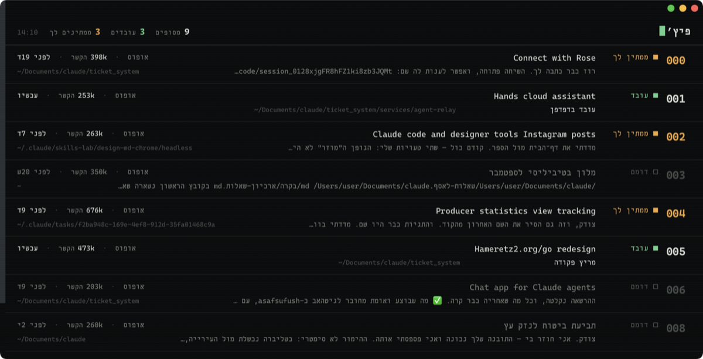
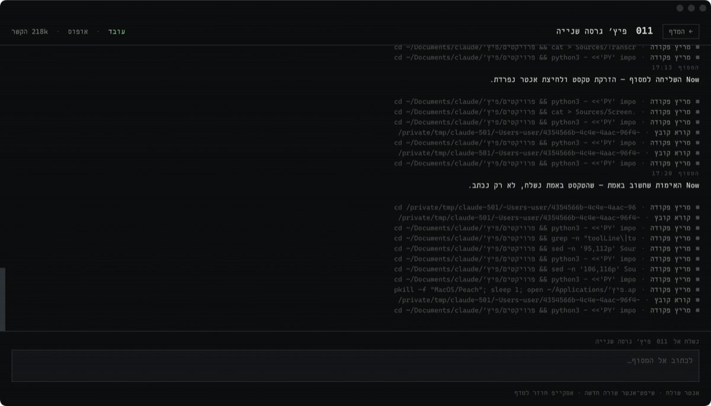
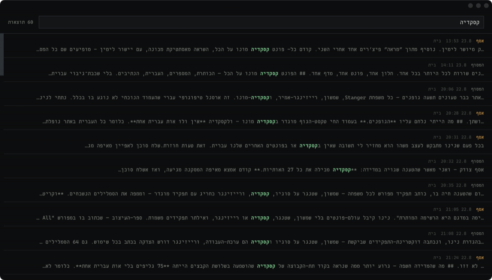
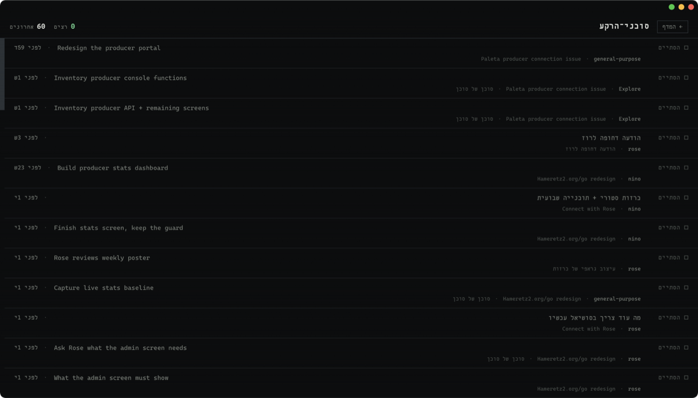

# Peach — every Claude Code session on one screen

**A free macOS app that shows every Claude Code session you have running, lets you
answer any of them without hunting for the right terminal window, and searches
everything you have ever said.**

This is not Claude Desktop, and not another chat client. Every row below is a real
terminal running real `claude`. Peach reads the session files and the terminal
screen, shows you what is happening, and types your answer back into that same
terminal. Drop back to the terminal at any moment — it is the same session, seen
from a different angle.

No model, no server, no account.

### [⬇ Download the latest release](https://github.com/asafsufush/peach/releases/latest)

macOS 12 or later · Apple silicon · under a megabyte · signed and notarised by
Apple, so it opens on a double-click.

---

## What it does

**One rack.** Every session on its own line: station number, state, model, context
size, and the last thing that was said. Three states, at a glance — working,
waiting for you, idle.

**Questions answered in one click.** When Claude stops to ask you something, the
question and its options surface here, and clicking answers it in that terminal.
This is the thing people keep the app open for.

**Reply without switching windows.** "Continue" · "Try again" straight from the row.

**Search everything ever said** — across every project, including sessions whose
terminals were closed long ago.

**Background agents** — what each one is doing right now.

**Restore** closed sessions back into terminal windows.

**Files and images inline** — a document or a screenshot opens inside the
conversation instead of sending you to Finder.

---

## Right-to-left text that actually reads correctly

This is the part no other Claude Code client does.

Apple's Terminal implements the Unicode bidirectional algorithm incorrectly. One
Latin word between two Hebrew or Arabic words — a filename, a flag, a package
name, which is to say *most of what a coding agent prints* — drags part of the line
with it, and you read the sentence in an order it was never written in. It is not a
font problem and not an encoding problem. It is an ordering problem, and it makes
the terminal genuinely unusable for a whole set of languages.

Peach renders the same bytes in a browser engine, which carries a complete and
tested implementation of the algorithm.

Hebrew · Arabic · Persian · Urdu · Yiddish · Dhivehi · Sindhi.

---

## What it costs

**Free, and it stays free.** No trial, no tier, no account, nothing held back.

---

## What it is not

- **No server and no account.** It reads local session files. Nothing leaves the machine.
- **No telemetry.** Nothing is counted and nothing is collected.
- **The source is not published here.** This repository is the download and the
  issue tracker. That is a deliberate choice, and it is the honest reason there is
  no `src/` directory to look at.

## Found a bug?

[Open an issue](https://github.com/asafsufush/peach/issues) — with your macOS
version and what happened.

Interface in English and Hebrew. · [peach.dev-stuff.org](https://peach.dev-stuff.org)

Built by [Asaf Hameiri](https://www.dev-stuff.org/), who runs a culture centre in
Tel Aviv and built its entire ticketing and operations stack with Claude Code —
which is how the terminal's Hebrew problem became impossible to ignore.

---
---

# פיץ׳ — כל שיחות קלוד־קוד במסך אחד

**זה לא קלוד־דסקטופ. זה קלוד־קוד עצמו, עם מסכה אחרת.**

פיץ׳ אינו עוטף את קלוד־קוד ואינו מחליף אותו. כל שורה במדף היא מסוף
אמיתי שרץ באמת. פיץ׳ קורא את קובצי־השיחה ואת מסך־המסוף, מראה לך מה
קורה, ומזריק את התשובה שלך בחזרה לאותו מסוף. אפשר לחזור למסוף בכל
רגע, ושום דבר לא הולך לאיבוד — זו אותה שיחה, רק מזווית אחרת.

בלי מודל, בלי שרת, בלי חשבון.

## להוריד

**[הגרסה האחרונה ←](https://github.com/asafsufush/peach/releases/latest)**

מערכת 12 ומעלה · מעבד אפל · פחות ממגה · חתום ומאושר אצל אפל, ונפתח
בלחיצה כפולה.

## מה יש בו

| | |
|---|---|
| **מדף** | כל מסוף בשורה — מספר־עמדה, מצב, מודל, גודל־הקשר, והמשפט האחרון |
| **שאלה נענית בלחיצה** | כשקלוד שואל, השאלה והאפשרויות מופיעות כאן, ולחיצה עונה במסוף ההוא |
| **תשובה בלי להיכנס** | ״תמשיך״ · ״נסה שוב״ ישר מהשורה |
| **חיפוש** | בכל מה שנאמר אי־פעם, גם בשיחות שנסגרו |
| **מסמכים ותמונות** | נפתחים בתוך השיחה |
| **סוכני־רקע** | מה כל אחד עושה ברגע זה |
| **שחזור** | שיחות שנסגרו חוזרות לחלונות־מסוף |

## עברית שנקראת נכון

המסוף של אפל מיישם שגוי את האלגוריתם הדו־כיווני. מילה לועזית אחת בין
שתי מילים עבריות — שם־קובץ, דגל, שם־חבילה, כלומר רוב מה שסוכן־קוד
מדפיס — גוררת איתה חלק מהשורה, ואתה קורא את המשפט בסדר אחר מזה שנכתב.
זו אינה בעיית־גופן אלא בעיית־סדר.

פיץ׳ מרנדר את אותם הבתים במנוע של דפדפן, שנושא מימוש מלא ובדוק של
האלגוריתם. עברית, ערבית, פרסית, אורדו, יידיש, דיבהי וסינדהי.

## כמה זה עולה

**חינם, וזה נשאר ככה.** בלי תקופת־ניסיון, בלי מדרגות, ובלי חשבון.

## ⛔ מה שאין

- **בלי שרת ובלי חשבון.** הוא קורא קבצים מקומיים. שום דבר לא יוצא החוצה.
- **בלי מדידה ובלי איסוף.**
- **קוד־המקור אינו כאן.** המאגר הזה הוא מקום ההורדה ומקום הדיווח.

## מצאת באג

[פתח דיווח](https://github.com/asafsufush/peach/issues) — עם גרסת־המערכת
ומה שקרה.

